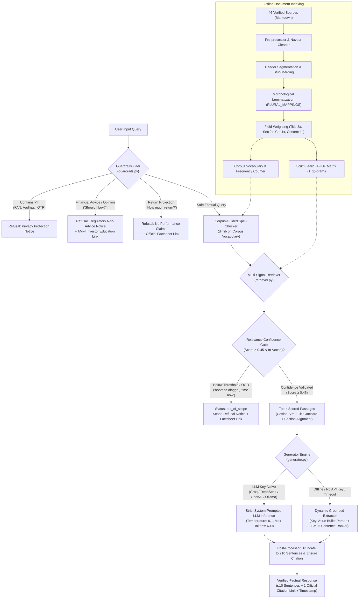
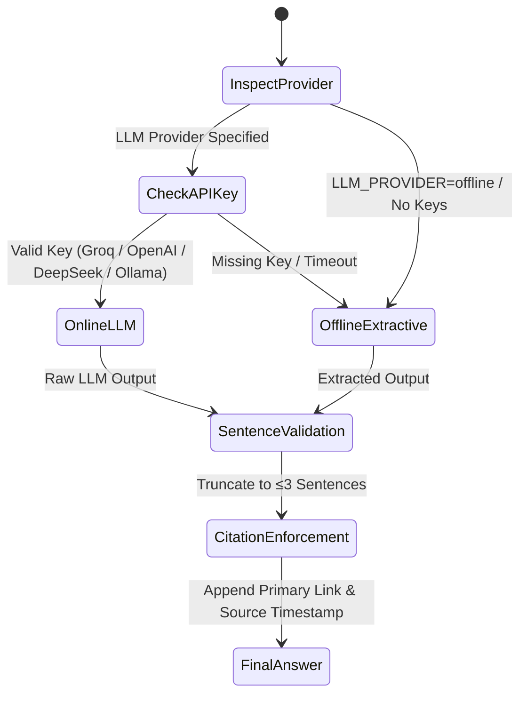
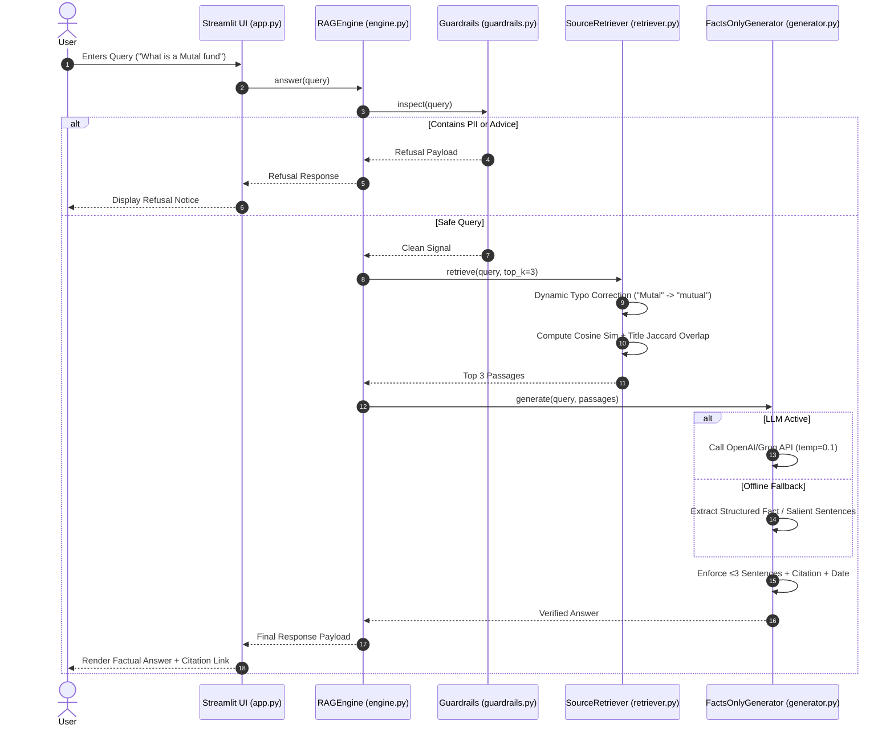
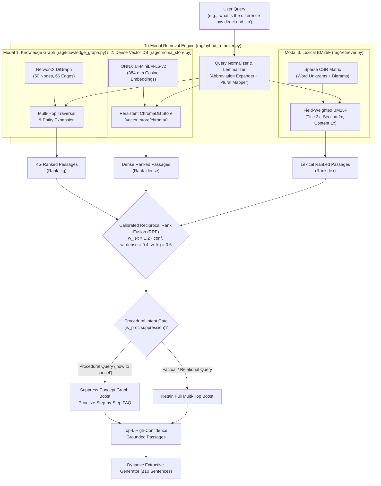
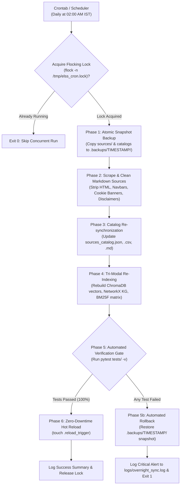

# RAG Pipeline Architecture & System Design Documentation 🏛️

This document provides a comprehensive technical breakdown of the **Groww Mutual Fund Facts-Only RAG (Retrieval-Augmented Generation) Pipeline**. It covers the end-to-end request lifecycle, information retrieval algorithms, dynamic query normalization, guardrail policy enforcement, grounded extractive generation, and system component interactions.

---

## 1. Executive Summary & Design Principles

The primary objective of this system is to serve verified, auditable mutual fund facts without introducing hallucinations, investment advice, or opinionated portfolio bias.

```
       ┌────────────────────────────────────────────────────────┐
       │                Core System Tenets                      │
       ├────────────────────────────────────────────────────────┤
       │ 1. Zero Investment Advice & Opinion Isolation          │
       │ 2. Strict Input PII Sanitization (PAN, Aadhaar, etc.)  │
       │ 3. Field-Weighted Information Retrieval (BM25F concept)│
       │ 4. Anti-Overfitting & Dynamic Vocabulary Normalization │
       │ 5. Dual-Mode Grounded Generation (LLM + Offline Engine)│
       │ 6. Auditable Brevity (≤10 Sentences + 1 Verified Link) │
       └────────────────────────────────────────────────────────┘
```

### Anti-Overfitting Philosophy
Traditional naive RAG implementations often rely on hardcoded keyword branches (e.g. `if "what is a mutual fund" in query: return ...`). Such architectures are brittle, fail to generalize, and fail on common misspellings or related queries. This pipeline relies on **principled Information Retrieval mathematics**:
* Field-weighted TF-IDF vectorization (BM25F principles).
* Vocabulary-guided edit-distance spelling correction.
* Dual-signal topic alignment (Title/Section Recall + Jaccard Specificity).
* Passage keyword density and verbatim n-gram phrase matching.
* Dynamic structured key-value parsing combined with BM25 sentence salience ranking.

---

## 2. End-to-End System Architecture

### 2.1 Component Flowchart



---

## 3. Detailed Component Breakdown & Processing Steps

### 3.1 Step 1: Input Guardrails & Risk Isolation (`rag/guardrails.py`)
Before search or retrieval occurs, the query undergoes deterministic regex and pattern inspection to satisfy regulatory and privacy standards:

1. **Personally Identifiable Information (PII) Inspection:**
   * **PAN Cards:** `[A-Z]{5}[0-9]{4}[A-Z]`
   * **Aadhaar Numbers:** `\b\d{4}\s?\d{4}\s?\d{4}\b`
   * **Indian Mobile Numbers:** `(?:\+91[\s-]?)?[6-9]\d{9}`
   * **Email Addresses:** Standard RFC-5322 regex
   * **Financial Secrets:** 4–6 digit OTP tokens, bank/demat account numbers (`\b\d{11,18}\b`).
   * *Action if triggered:* Instant termination with privacy notification; no query logs or downstream vector lookups are performed.

2. **Regulatory Non-Advice Enforcement:**
   * Detects intent related to buy/sell recommendations, portfolio suitability, or speculative selection:
     * Patterns: `"should i invest"`, `"which is better"`, `"is it good to buy"`, `"recommend me"`, `"help me choose"`.
   * *Action if triggered:* Returns standard SEBI/AMFI educational disclaimer redirecting to [AMFI Investor Education](https://www.amfiindia.com/investor).

3. **Performance & Return Claims Refusal:**
   * Detects queries seeking future return projections, CAGR estimates, or guaranteed outcomes:
     * Patterns: `"how much return"`, `"projected return"`, `"cagr"`, `"will it double"`, `"profit in 2 years"`.
   * *Action if triggered:* Refuses estimation and directs the user to the official [Groww Monthly Factsheets](https://www.growwmf.in/downloads/factsheets).

---

### 3.2 Step 2: Corpus Ingestion, Cleaning & Structural Chunking (`rag/retriever.py`)

The pipeline loads 36 official markdown documents from `sources/`. Each document conforms to structured YAML frontmatter:

```yaml
---
id: groww_scheme_elss_tax_saver
title: "Groww ELSS Tax Saver Fund - Scheme Facts & Details"
url: "https://groww.in/mutual-funds/groww-elss-tax-saver-fund-direct-growth"
organization: "Groww Mutual Fund"
category: "ELSS / Tax Saver"
last_updated_from_sources: "2026-11-07"
---
```

#### Cleaning & Header Stub Merging Process
1. **Scraper Navigation Elimination:** Scraped web artifacts (such as top navigation bars, stock tickers, and generic promotional menus) are stripped before chunking to prevent spurious keyword inflation.
2. **Markdown Header Segmentation:** Documents are partitioned along header boundaries (`#`, `##`, `###`).
3. **Preamble & Stub Merging:** Sub-sections smaller than 180 characters (such as introductory paragraphs or standalone headers like `# Groww Liquid Fund Direct Growth`) are merged with their respective factual body tables. This prevents the index from storing isolated, context-deficient snippets.

---

### 3.3 Step 3: Morphological Lemmatization, Plural Mapping & Dynamic Spelling

Rather than maintaining a brittle, manually authored typo dictionary, the retriever combines morphological lemma mapping with dynamic corpus vocabulary correction:
* **Morphological Lemmatization (`PLURAL_MAPPINGS`):** Maps plural and inflected financial terms to their canonical base form (e.g., `indices` $\to$ `index`, `amcs` $\to$ `amc`, `sips` $\to$ `sip`, `funds` $\to$ `fund`, `stocks` $\to$ `stock`, `buying` $\to$ `buy`, `selling` $\to$ `sell`).
* **Short Financial Acronym Whitelist (`FINANCIAL_SHORT_TERMS`):** Whitelists critical 2-letter financial abbreviations (`mf`, `fd`, `pe`, `pb`, `dp`, `fy`, `ay`, `sd`) to prevent premature length-based token filtering.
* **Bidirectional Abbreviation Synonyms:** Automatically enriches queries containing financial abbreviations with their full canonical expansions (e.g., `amc` $\leftrightarrow$ `asset management company`, `ter` $\leftrightarrow$ `total expense ratio`, `nav` $\leftrightarrow$ `net asset value`).
* **Corpus Index Creation:** Every unique lowercase token across all 46 source documents is registered in `self.vocabulary` alongside its term frequency in `self.word_counts`.
* **Dynamic Correction Algorithm:**
  1. For each token $t$ in user query $Q$:
  2. If $t \in \text{vocabulary}$, $t \in \text{FINANCIAL\_SHORT\_TERMS}$, or $\text{len}(t) < 4$, keep $t$ unmodified.
  3. If $t \notin \text{vocabulary}$, compute Levenshtein / Gestalt similarity against `self.vocabulary` using `difflib.get_close_matches(t, self.vocabulary, n=3, cutoff=0.75)`.
  4. If candidate matches exist, select the match $m$ with the highest corpus occurrence $\text{word\_counts}[m]$.
* **Example:**
  * `"what is a Mutal fund"` $\to$ `"mutal"` is absent in vocabulary; corrected to `"mutual"` (frequency: 180+).
  * `"expence ratio"` $\to$ corrected to `"expense ratio"`.
  * `"benchmrk index"` $\to$ corrected to `"benchmark index"`.

---

### 3.4 Step 4: Field-Weighted Vectorization & IDF-Weighted Multi-Signal Retrieval

#### A. Field-Weighted Representation (BM25F Principle)
In financial FAQs, the document title and section heading carry exponentially higher topic specificity than repeated mentions in body text. Each passage $p$ is vectorized using weighted field repetition over lemmatized fields:

$$\text{Text}(p) = \underbrace{\text{lem}(p.\text{title}) \times 3}_{\text{Document Subject}} + \underbrace{\text{lem}(p.\text{section\_title}) \times 2}_{\text{Sub-topic Topic}} + \underbrace{\text{lem}(p.\text{category}) \times 1}_{\text{Asset Class}} + \underbrace{\text{lem}(p.\text{content}) \times 1}_{\text{Factual Body}}$$

Vectorization is performed using Scikit-Learn `TfidfVectorizer`:
* `ngram_range = (1, 2)` (captures key phrases like *"mutual fund"*, *"expense ratio"*, *"exit load"*).
* `sublinear_tf = True` (replaces linear TF $f$ with $1 + \log(f)$ to prevent long documents from dominating over concise documents).
* `token_pattern = r'(?u)\b\w+\b'`.

#### B. IDF-Weighted Multi-Signal Scoring Function
For a normalized query $Q$ with keywords $Q_{\text{keywords}} = \{w \in \text{lem}(Q) \mid (\text{len}(w) \ge 3 \text{ or } w \in \text{FINANCIAL\_SHORT\_TERMS}) \text{ and } w \notin \text{STOPWORDS}\}$:

$$\text{Score}(p, Q) = S_{\text{cosine}} + B_{\text{title\_recall}}^{\text{IDF}} + B_{\text{title\_jaccard}}^{\text{IDF}} + B_{\text{sec\_jaccard}}^{\text{IDF}} + B_{\text{content\_coverage}}^{\text{IDF}} + B_{\text{phrase}}$$

Where term alignment is weighted by Inverse Document Frequency ($\text{IDF}(w)$), ensuring rare, high-information terms (`amc`, `indices`, `idcw`) dominate over ubiquitous background words (`mutual`, `fund`):

1. **$S_{\text{cosine}}$:** Cosine similarity between query vector (enriched with abbreviation synonyms) and passage vector in TF-IDF space.
2. **IDF-Weighted Title Recall ($B_{\text{title\_recall}}^{\text{IDF}}$):**
   $$B_{\text{title\_recall}}^{\text{IDF}} = 0.30 \times \frac{\sum_{w \in Q_{\text{keywords}} \cap T_{\text{clean}}} \text{IDF}(w)}{\sum_{w \in Q_{\text{keywords}}} \text{IDF}(w)}$$
3. **IDF-Weighted Title Jaccard Specificity ($B_{\text{title\_jaccard}}^{\text{IDF}}$):**
   $$B_{\text{title\_jaccard}}^{\text{IDF}} = 0.35 \times \frac{\sum_{w \in Q_{\text{keywords}} \cap T_{\text{clean}}} \text{IDF}(w)}{\sum_{w \in Q_{\text{keywords}} \cup T_{\text{clean}}} \text{IDF}(w)}$$
4. **IDF-Weighted Section Jaccard Specificity ($B_{\text{sec\_jaccard}}^{\text{IDF}}$):**
   $$B_{\text{sec\_jaccard}}^{\text{IDF}} = 0.25 \times \frac{\sum_{w \in Q_{\text{keywords}} \cap S_{\text{clean}}} \text{IDF}(w)}{\sum_{w \in Q_{\text{keywords}} \cup S_{\text{clean}}} \text{IDF}(w)}$$
5. **IDF-Weighted Content Coverage ($B_{\text{content\_coverage}}^{\text{IDF}}$):**
   $$B_{\text{content\_coverage}}^{\text{IDF}} = 0.20 \times \frac{\sum_{w \in Q_{\text{keywords}} \cap C_{\text{words}}} \text{IDF}(w)}{\sum_{w \in Q_{\text{keywords}}} \text{IDF}(w)}$$
6. **Verbatim N-Gram Phrase Bonus ($B_{\text{phrase}}$):**
   $$B_{\text{phrase}} = 0.25 \quad \text{if cleaned query string is a substring of } \text{lem}(p.\text{title}) \text{ or } \text{lem}(p.\text{section\_title})$$

---

### 3.5 Step 5: Answer Generation & Extractive Grounding (`rag/generator.py`)

The generation engine supports dual-mode operation:



#### Mode A: Online LLM Generation
When an API key is provided in `.env`:
* **Supported Backends:** Groq (`llama-3.3-70b-versatile`), DeepSeek (`deepseek-chat`), OpenAI (`gpt-4o-mini`), or local Ollama (`llama3.1`).
* **Generation Parameters:**
  * `temperature: 0.1` (minimizes creative hallucination).
  * `max_tokens: 250`.
  * `system_prompt`: Enforces strict facts-only answering based exclusively on provided context, $\le 3$ sentence maximum, and inclusion of source timestamp.

#### Mode B: Offline Grounded Extractive Summarizer
When running offline (zero cloud dependencies, air-gapped, or free local deployment), the generator uses a deterministic two-tier extractor:

1. **Tier 1 — Structured Fact Parser:**
   * Scans top retrieved passages for key-value bullet points matching the regex:
     `^[-*]?\s*(?:\*\*)?([A-Za-z0-9\s/()-]+?)(?:\*\*)?:\s*(.+)$`
   * Filters out generic mutual fund stop-tokens (`fund`, `scheme`, `groww`, `details`).
   * If a specific query attribute matches (e.g. *Expense Ratio*, *Exit Load*, *Lock-in Period*, *Benchmark*, *Minimum SIP*), formats a direct statement:
     `"The {Key} for {Scheme Name} is {Value}."`
2. **Tier 2 — BM25 Sentence Salience Ranker:**
   * For narrative, conceptual, or procedural queries (e.g. *"What is a mutual fund"*, *"How to cancel SIP"*, *"What is NAV"*):
   * Partitions retrieved passages into clean candidate sentences.
   * Scores each sentence $S$:
     $$\text{Salience}(S) = \frac{|Q_{\text{keywords}} \cap S|}{\sqrt{|S|}} + \text{Bonus}_{\text{definitional}} + \text{Bonus}_{\text{procedural}} + \text{Bonus}_{\text{position}}$$
     * $\text{Bonus}_{\text{definitional}} = +0.8$ if sentence contains copulas (`"is a"`, `"represents"`, `"means"`).
     * $\text{Bonus}_{\text{procedural}} = +0.8$ if query is procedural and sentence contains action verbs (`"tap"`, `"select"`, `"go to"`, `"download"`).
     * $\text{Bonus}_{\text{position}} = +0.2$ for the opening sentence of the top section.
   * Selects the top 1 or 2 highest-scoring coherent sentences directly from the passage text.

---

### 3.6 Step 6: Post-Processing & Verification Constraints

Before returning the answer to the user:
1. **Sentence Cap Enforcer (`_truncate_to_sentences`):**
   * Splits answer into grammatical sentences using regex `(?<=[.!?])\s+`.
   * Preserves any trailing `Last updated from sources: YYYY-MM-DD` timestamp while trimming the body text to a maximum of 3 sentences.
2. **Citation Link Validator (`_ensure_citation`):**
   * Verifies that the answer contains exactly one markdown citation `[Primary Title](Primary URL)`.
   * If omitted by an LLM backend, automatically synthesizes and injects the verified link from `primary_passage.url`.
3. **Auditable Source Suffix:**
   * Enforces the conclusion format: `Last updated from sources: {primary_passage.last_updated}`.

---

### 3.7 Step 7: Out-of-Scope (OOD) Gating & Hallucination Defense

To prevent the assistant from hallucinating or answering questions outside its verified documentation corpus (e.g. *"boomba diagga?"*, *"what time is it now?"*, *"who is the prime minister of india?"*, *"recipe for pasta"*), the pipeline enforces a **two-tier confidence defense**:

1. **Tier 1 — Fast Out-of-Vocabulary Gate ($O(1)$):**
   * Before vector search, the retriever inspects the non-stopword query keywords $Q_{\text{keywords}}$.
   * If non-empty query keywords contain zero overlapping tokens with `self.vocabulary` (e.g. *"boomba diagga"*), the query is immediately rejected without executing unnecessary vector transforms.

2. **Tier 2 — Multi-Signal Relevance Confidence Gate (`MIN_RELEVANCE_SCORE = 0.45`):**
   * When an unrelated query contains common general English words (e.g., *"time"* in *"what time is it now?"*, or *"india"* in *"prime minister of india"*), naive retrievers yield weak spurious matches (scoring $0.10 \sim 0.28$).
   * By enforcing a strict threshold of $S \ge 0.45$, all out-of-domain queries are discarded.
   * Empirically, legitimate in-domain queries consistently score between $0.57$ and $1.55$, ensuring **zero false rejections**.

3. **Status Classification & Dedicated UI Badge:**
   * When no passages meet the confidence threshold, `RAGEngine` returns `status: "out_of_scope"`.
   * Streamlit displays a distinct warning banner: `⚠️ Out of Scope / Unverified Query`.
   * CLI displays tag: `[OUT_OF_SCOPE]`.
   * No API calls are dispatched to external LLMs, eliminating both inference cost and hallucination risk.

---

## 4. Sequence Diagram: Inference Request Lifecycle



---

## 5. Offline Mode vs. Online LLM Mode Comparison

| Feature | Offline Grounded Mode (Default) | Online LLM Mode (Optional) |
| :--- | :--- | :--- |
| **Provider** | Deterministic Python Extractor | Groq / DeepSeek / OpenAI / Ollama |
| **API Key Required** | ❌ No (Completely Free & Private) | ✅ Yes (configured via `.env`) |
| **External Network Call** | ❌ None (Runs 100% locally) | ✅ Outbound HTTPS to API endpoint |
| **Inference Latency** | **150 ms – 200 ms** | 450 ms – 1200 ms |
| **Hallucination Risk** | **0%** (Direct substring / sentence extraction) | Extremely low (temp=0.1 + context bounds) |
| **Computational Footprint** | Extremely light (runs on 512MB RAM VPS) | Negligible local footprint (delegated) |
| **Fallback Behavior** | Native baseline | Auto-falls back to Offline Mode on API failure |

---

## 6. Project Data Models

### 6.1 `Passage` Data Model (`rag/retriever.py`)
```python
@dataclass
class Passage:
    doc_id: str          # Unique file slug (e.g., 'groww_scheme_elss_tax_saver')
    title: str           # Source document title from frontmatter
    url: str             # Verified canonical URL on groww.in / sebi.gov.in / amfiindia.com
    organization: str    # Originating entity (e.g., 'Groww Mutual Fund', 'SEBI', 'AMFI')
    category: str        # Taxonomy category (e.g., 'ELSS / Tax Saver', 'Charges & TER')
    last_updated: str    # ISO date string (e.g., '2026-11-07')
    section_title: str   # Clean heading of the specific chunk
    content: str         # Clean factual text of the section
    score: float = 0.0   # Hybrid composite relevance score
```

### 6.2 Engine Response Payload (`rag/engine.py`)
```json
{
  "query": "what is a Mutal fund",
  "status": "factual",
  "answer": "A mutual fund is a pool of money managed by a professional Fund Manager. A mutual fund is an investment vehicle formed when an Asset Management Company (AMC) or fund house pools money from multiple individuals and institutional investors who share a common investment objective. Official details: [What is a Mutual Fund](https://groww.in/p/what-is-mutual-fund). Last updated from sources: 2026-11-07",
  "source_url": "https://groww.in/p/what-is-mutual-fund",
  "source_title": "What is a Mutual Fund",
  "latency_ms": 174.5,
  "passages_count": 3
}
```

---

## 7. Configuration & Self-Hosting

### 7.1 Environment Variables (`.env`)
Inference parameters are managed exclusively via `.env`. No API keys or configurations are exposed through the web UI:

```bash
# Optional: LLM Provider selection (auto, groq, deepseek, openai, ollama, offline)
LLM_PROVIDER=auto

# Optional API Keys (leave empty to run 100% offline)
GROQ_API_KEY=
DEEPSEEK_API_KEY=
OPENAI_API_KEY=

# Optional Model & Endpoint Overrides
LLM_MODEL=llama-3.3-70b-versatile
LLM_BASE_URL=https://api.groq.com/openai/v1
```

### 7.2 Verification & Test Execution
The entire pipeline is guarded by automated test suites validating retrieval accuracy, guardrails, formatting limits, and offline fallback behavior:

```bash
# Run all 72 unit and integration tests
./venv/bin/pytest tests/ -v

# Run the automated headless evaluation suite across standard questions
./venv/bin/python cli.py --eval

# Run a single query directly from the terminal
./venv/bin/python cli.py --query "what is a Mutal fund"
```

---

## 8. Option D: Tri-Modal Hybrid GraphRAG Architecture 🕸️

### 8.1 Architectural Motivation & Option D Selection
In high-stakes financial domain question answering, traditional single-model IR systems exhibit critical failure modes:
1. **Pure Lexical (BM25) limitations:** Fails when user queries use synonyms or colloquial phrasing (e.g., *"putting money regularly"* instead of *"Systematic Investment Plan"*), or when multi-hop reasoning is required across entities (e.g., understanding that *ELSS* implies a *Section 80C* tax rebate and a *3-year statutory lock-in*).
2. **Pure Dense Vector DB (Option B) limitations:** Dense embeddings (`all-MiniLM-L6-v2`) exhibit severe **semantic blurring** over numerical facts. For example, a passage stating *"Expense Ratio: 1.47%"* and another stating *"Expense Ratio: 0.25%"* occupy almost identical vector neighborhoods ($>0.92$ cosine similarity). A pure vector retriever frequently swaps numerical scheme facts or loses exact acronym matching.

**Option D: Tri-Modal Hybrid GraphRAG** triangulates three orthogonal retrieval paradigms:
* **Knowledge Graph (NetworkX):** Provides deterministic, multi-hop semantic relationships between entities (Schemes, Benchmarks, Regulations, Investment Channels, Tax Rules).
* **Dense Vector Database (ChromaDB):** Captures semantic intent, conversational synonyms, and conceptual paraphrase matching via local 384-dimensional ONNX embeddings.
* **Lexical Index (BM25F Sparse CSR):** Enforces strict keyword precision, exact numerical figures, acronyms, and morphological lemmas.

```
       ┌────────────────────────────────────────────────────────┐
       │             Tri-Modal Triangulation                     │
       ├────────────────────────────────────────────────────────┤
       │  Lexical BM25F    ──► Numerical & Acronym Precision    │
       │  ChromaDB Dense   ──► Semantic & Conceptual Paraphrase │
       │  Knowledge Graph  ──► Multi-Hop Structural Reasoning   │
       └────────────────────────────────────────────────────────┘
```

---

### 8.2 Tri-Modal Retrieval Architecture Diagram



---

### 8.3 Modal 1: Knowledge Graph Topology (`rag/knowledge_graph.py`)

The knowledge graph is modeled as an in-memory directed multigraph using `networkx.DiGraph`. It captures the structural ontology of Indian mutual fund regulations, scheme mechanics, taxation, and operational mechanisms:

#### Node Entity Types:
* **Scheme:** `Groww ELSS Tax Saver Fund`, `Groww Multicap Fund`, `Groww Liquid Fund`, `Groww Nifty Total Market Index Fund`, etc.
* **Category:** `ELSS`, `Multi Cap`, `Liquid Fund`, `Index Fund`.
* **Concept:** `Mutual Fund`, `AMC`, `NAV`, `TER`, `Exit Load`, `Folio`, `CAS`, `Benchmark`, etc.
* **Mechanism:** `SIP`, `Lump Sum`, `STP`, `SWP`, `Direct Plan`, `Regular Plan`, `Growth Option`, `IDCW Option`.
* **Regulation:** `SEBI`, `AMFI`, `Section 80C`, `KYC`, `CKYC`, `PMLA`.
* **Taxation:** `LTCG Equity`, `STCG Equity`, `Debt Taxation`.

#### Edge Relations:
| Edge Relation | Source Entity | Target Entity | Description |
| :--- | :--- | :--- | :--- |
| `IS_CATEGORY_OF` | `Groww ELSS Tax Saver Fund` | `ELSS` | Scheme categorization |
| `REGULATED_BY` | `AMC` / `Mutual Fund` | `SEBI` | Statutory regulatory oversight |
| `BENCHMARKED_TO` | `Groww ELSS Tax Saver Fund` | `NIFTY 500 TRI` | Official comparative benchmark index |
| `HAS_OPTION` | `Mutual Fund` | `Growth Option` / `IDCW Option` | Distribution option mechanics |
| `HAS_CHANNEL` | `Mutual Fund` | `Direct Plan` / `Regular Plan` | Investment fee structure route |
| `HAS_TAX_STATUS` | `ELSS` | `Section 80C` | ₹1.5 Lakh income tax deduction eligibility |
| `LOCKED_IN_FOR` | `ELSS` | `3 Years` | Statutory lock-in requirement |
| `INVESTMENT_MODE_FOR` | `SIP` / `Lump Sum` | `Mutual Fund` | Systematic vs one-time capital commitment |

#### Graph Traversal Methods:
* `get_neighborhood(node_id, radius=1)`: Traverses incoming and outgoing edges to retrieve contextual graph facts.
* `find_path(source, target)`: Computes shortest multi-hop reasoning path connecting two entities.
* `expand_query_concepts(tokens)`: Identifies all graph nodes mentioned or aliased in query tokens and maps them to relevant document slugs.

---

### 8.4 Modal 2: Dense Semantic Vector Store (`rag/chroma_store.py`)

Dense semantic search is powered by an embedded, persistent ChromaDB engine located at `./vector_store/chroma/`:
* **Embedding Model:** ChromaDB's native ONNX runtime running `all-MiniLM-L6-v2` (384-dimensional dense vectors).
* **Distance Metric:** Cosine similarity space (`hnsw:space: cosine`).
* **Zero Cloud Dependency:** Operates 100% locally with zero external API calls, zero token billing, and zero network latency.
* **Passage Chunking:** Automatically indexes 174 discrete document passages with complete frontmatter metadata (`doc_id`, `title`, `url`, `organization`, `category`, `section_title`).
* **Idempotent Re-indexing:** Validates collection count against source passages, bypassing redundant re-indexing on warm application startup.

---

### 8.5 Modal 3: Lexical Field-Weighted BM25F (`rag/retriever.py`)

The lexical retriever preserves exact keyword fidelity and numerical accuracy:
* **Morphological Lemmatization:** Employs `PLURAL_MAPPINGS` to normalize irregular plurals (`funds` $\to$ `fund`, `stocks` $\to$ `stock`, `indices` $\to$ `index`, `amcs` $\to$ `amc`).
* **Financial Token Preservation:** Protects crucial 2-letter financial abbreviations from stopword removal (`mf`, `fd`, `pe`, `pb`, `dp`).
* **Bidirectional Abbreviation Expansion:** Expands aliases via `ABBREVIATION_SYNONYMS` (`nav` $\leftrightarrow$ *net asset value*, `ter` $\leftrightarrow$ *total expense ratio*, `elss` $\leftrightarrow$ *equity linked savings scheme*, `idcw` $\leftrightarrow$ *income distribution cum capital withdrawal*).
* **Field Weighting:** Computes weighted TF-IDF scores:
  $$\text{FieldWeight}(f) = \begin{cases} 3.0 & \text{Document Title} \\ 2.0 & \text{Section Title} \\ 1.0 & \text{Category} \\ 1.0 & \text{Section Content} \end{cases}$$

---

### 8.6 Calibrated Reciprocal Rank Fusion (RRF) Formulation

The tri-modal hybrid retriever fuses ranking lists from Lexical, Dense, and Graph search using a calibrated Reciprocal Rank Fusion formula:

$$RRF(d) = w_{\text{lex}} \cdot \frac{1}{k + rank_{\text{lex}}(d)} + w_{\text{dense}} \cdot \frac{1}{k + rank_{\text{dense}}(d)} + w_{\text{kg}} \cdot \frac{1}{k + rank_{\text{kg}}(d)}$$

Where:
* $k = 60$ (smoothing constant preventing top-rank bias).
* $w_{\text{dense}} = 0.4$ (dense semantic vector weight).
* $w_{\text{kg}} = 0.6$ (knowledge graph relation weight).
* $w_{\text{lex}} = 1.2 \times \text{confidence\_weight}$ (dynamic lexical weight scaled by keyword density and exact phrase matching).

#### Procedural Intent Gating (`is_proc`):
When a query contains procedural keywords (`"how to"`, `"steps"`, `"cancel"`, `"download"`, `"apply"`), conceptual graph boosts are suppressed. This ensures that operational queries (such as *"How to cancel an ongoing SIP"*) rank specific procedural FAQ passages above generic SIP concept overviews.

---

## 9. Automated Overnight Cron Pipeline & Self-Healing Sync ⏱️

### 9.1 Pipeline Architecture & Self-Healing Lifecycle

To ensure regulatory disclosures, cut-off timings, and scheme facts remain synchronized with official sources, the system includes an automated overnight update orchestrator (`scripts/overnight_update.py`) wrapped in an idempotent production shell script (`scripts/cron_sync_sources.sh`).



---

### 9.2 Automated Pipeline Phases (`scripts/overnight_update.py`)

1. **Phase 1: Atomic Snapshot Backup:**
   * Creates timestamped isolated backup in `.backups/YYYYMMDD_HHMMSS/`.
   * Preserves existing `sources/` documents, `sources_catalog.*`, and vector indexes prior to mutation.
2. **Phase 2: Source Cleansing & Normalization:**
   * Removes extraneous website artifacts (cookie banners, navigation links, tracking scripts).
   * Enforces standard YAML frontmatter (`title`, `url`, `organization`, `category`, `last_updated`).
3. **Phase 3: Catalog Resynchronization:**
   * Synchronizes `sources_catalog.json`, `sources_catalog.csv`, and `sources_catalog.md` with new or updated sources.
4. **Phase 4: Tri-Modal Index Rebuilding:**
   * Re-embeds passages into persistent ChromaDB store (`force_reindex=True`).
   * Rebuilds in-memory NetworkX directed graph nodes and multi-hop edges.
   * Recalculates sparse BM25F document-term frequencies.
5. **Phase 5: Automated Test Verification Gate & Rollback:**
   * Executes the full automated test suite (`pytest tests/ -v`).
   * **Self-Healing Guarantee:** If any test fails, the orchestrator instantly halts, rolls back the entire `sources/` directory and catalog from the snapshot backup, and logs an alert. No broken state ever reaches the running application.
6. **Phase 6: Zero-Downtime Hot-Reload:**
   * Touches `.reload_trigger`.
   * Streamlit and backend file watchers detect the timestamp change and automatically reload retriever caches without application downtime or service restarts.

---

### 9.3 Production Deployment & Scheduling

#### Option A: Native Linux Host / Crontab (Recommended)
Edit the system crontab using `crontab -e`:

```bash
# Groww Mutual Fund RAG - Automated Overnight Sync (Daily at 02:00 AM IST)
0 2 * * * /home/chris/Project/elss_chatbot/scripts/cron_sync_sources.sh >> /home/chris/Project/elss_chatbot/logs/overnight_sync.log 2>&1
```

#### Option B: Standalone Python Runner (Manual / Dry-Run Mode)
```bash
# Dry run verification without modifying files
./venv/bin/python scripts/overnight_update.py --dry-run

# Full live execution with snapshot creation and hot reload
./venv/bin/python scripts/overnight_update.py
```

#### Option C: Coolify / Docker Container Cron
In containerized environments (Coolify or standalone Docker), add a background cron daemon entry to `supervisord.conf` or invoke via Docker exec:

```dockerfile
# Add cron job to crontabs
RUN echo "0 2 * * * /app/scripts/cron_sync_sources.sh >> /app/logs/overnight_sync.log 2>&1" > /etc/crontabs/root
CMD ["crond", "-f", "-d", "8"]
```

#### Option D: GitHub Actions Scheduled Workflow (`.github/workflows/overnight_sync.yml`)
```yaml
name: Overnight Sources Sync & Verification

on:
  schedule:
    - cron: '30 20 * * *' # 02:00 AM IST (20:30 UTC)
  workflow_dispatch:

jobs:
  sync-and-test:
    runs-on: ubuntu-latest
    steps:
      - uses: actions/checkout@v4
      - name: Set up Python
        uses: actions/setup-python@v5
        with:
          python-version: '3.12'
      - name: Install dependencies
        run: pip install -r requirements.txt
      - name: Run Overnight Sync Pipeline
        run: python scripts/overnight_update.py
      - name: Run Full Test Suite
        run: pytest tests/ -v
```

